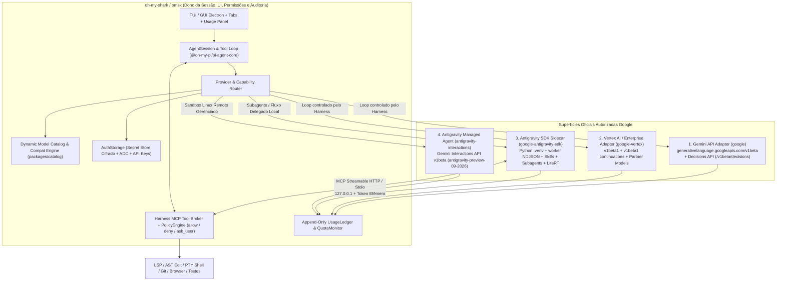

# Arquitetura Completa de Integração do Google Antigravity ao Harness (`oh-my-shark` / `omsk`)

> **Documento técnico de referência, engenharia reversa arquitetural e plano de implementação**  
> **Data de verificação:** 24 de novembro de 2026  
> **Base de código analisada:** `oh-my-shark` (fork de [`can1357/oh-my-pi`](https://github.com/can1357/oh-my-pi), upstream `fbb8085ff4`)  
> **Documentação e SDKs oficiais verificados:** `antigravity.google/docs`, `ai.google.dev/gemini-api/docs`, `cloud.google.com/vertex-ai`, [`google-antigravity/antigravity-sdk-python`](https://github.com/google-antigravity/antigravity-sdk-python)

---

## Sumário

1. [Objetivo, diagnóstico realista e fronteira de conformidade](#1-objetivo-diagnóstico-realista-e-fronteira-de-conformidade)
2. [Taxonomia oficial do ecossistema Google Antigravity](#2-taxonomia-oficial-do-ecossistema-google-antigravity)
3. [Tokens, quotas, modelos, janelas de contexto e capacidade máxima: o que é possível de verdade](#3-tokens-quotas-modelos-janelas-de-contexto-e-capacidade-máxima-o-que-é-possível-de-verdade)
4. [Anatomia exata de como `can1357/oh-my-pi` e `oh-my-shark` implementam o Antigravity](#4-anatomia-exata-de-como-can1357oh-my-pi-e-oh-my-shark-implementam-o-antigravity)
5. [Arquitetura-alvo no `oh-my-shark` para integração completa e sustentável](#5-arquitetura-alvo-no-oh-my-shark-para-integração-completa-e-sustentável)
6. [Especificação A: Provider nativo de máxima capacidade (`google` + `google-vertex` + `google-decisions`)](#6-especificação-a-provider-nativo-de-máxima-capacidade-google--google-vertex--google-decisions)
7. [Especificação B: Sidecar do `google-antigravity` SDK local + ponte MCP + LiteRT offline](#7-especificação-b-sidecar-do-google-antigravity-sdk-local--ponte-mcp--litert-offline)
8. [Especificação C: Agente remoto gerenciado via Gemini Interactions API (`antigravity-preview-09-2026`)](#8-especificação-c-agente-remoto-gerenciado-via-gemini-interactions-api-antigravity-preview-09-2026)
9. [Catálogo dinâmico honesto, variantes, raciocínio e janela de contexto](#9-catálogo-dinâmico-honesto-variantes-raciocínio-e-janela-de-contexto)
10. [Contabilização exata de tokens, custos, quotas e `UsageLedger`](#10-contabilização-exata-de-tokens-custos-quotas-e-usageledger)
11. [Máquina de erros, retries, circuit-breaking e fallbacks](#11-máquina-de-erros-retries-circuit-breaking-e-fallbacks)
12. [Segurança, isolamento de credenciais, Policy Engine e sandbox no Windows/POSIX](#12-segurança-isolamento-de-credenciais-policy-engine-e-sandbox-no-windowsposix)
13. [Roteiro de implementação dentro dos pacotes de `oh-my-shark`](#13-roteiro-de-implementação-dentro-dos-pacotes-de-oh-my-shark)
14. [Matriz de testes de aceitação (25 verificações obrigatórias)](#14-matriz-de-testes-de-aceitação-25-verificações-obrigatórias)
15. [O que NÃO implementar (antipadrões técnicos e violações de ToS)](#15-o-que-não-implementar-antipadrões-técnicos-e-violações-de-tos)
16. [Fontes primárias consultadas](#16-fontes-primárias-consultadas)

---

## 1. Objetivo, diagnóstico realista e fronteira de conformidade

O objetivo deste guia é detalhar com exatidão técnica **como integrar toda a pilha do Google Antigravity e Gemini ao harness (`oh-my-shark` / `omsk`)**, extraindo o **teto máximo real de inteligência, modelos, janela de contexto, ferramentas, criação multimodal/código e vazão operacional** sem fragilidades e sem colocar contas em risco de banimento.

### A verdade técnica sobre "integração irrestrita"

Antes de escrever código, é obrigatório separar **irrestrito em engenharia/capacidade** de **burlar restrições de licença/conta**:

1. **Não existe meio legítimo ou tecnicamente estável de "transferir" sua assinatura pessoal de consumidor do Antigravity (Free, Pro, Ultra) — com seus tokens OAuth pessoais, limites renováveis de 5 horas/semanais ou modelos parceiros exclusivos do app — para um harness autônomo de terceiros.**
   - A FAQ oficial atual do Antigravity (`antigravity.google/docs/faq`) afirma expressamente que usar software, ferramentas ou serviços de terceiros para acessar a assinatura de consumidor do Antigravity viola os Termos de Serviço e resulta em suspensão (`403 PERMISSION_DENIED` / `TOS_VIOLATION`).
   - O modo headless do CLI oficial (`agy -p`) destina-se a scripts e CI diretos, e a FAQ exclui o encapsulamento de `agy` dentro de agentes autônomos de terceiros em planos de consumidor, bem como rotação automatizada de contas para somar quotas.
   - O próprio `can1357/oh-my-pi` comprovou isso na prática: a issue `#18341` documentou suspensões reais de contas via `cloudcode-pa.googleapis.com` ao usar o provedor OAuth direto `google-antigravity`, levando o projeto a marcar a rota como incompatível/de risco (`wontfix`) e a adicionar avisos explícitos de risco (`login-warning` e issue `#19523`).

2. **Por outro lado, EXISTE um caminho 100% sancionado, programático, escalável e verdadeiramente poderoso** que oferece ao seu harness:
   - **Quotas e vazão sem teto fixo de consumidor** (escala por Tier de faturamento na Gemini API / AI Studio, `ServiceTier.PRIORITY` / `FLEX`, ou Vertex AI + Provisioned Throughput no Google Cloud);
   - **Runtime oficial completo do agente Antigravity** dentro do seu harness via **`google-antigravity` Python SDK** (com runtime binário compilado mantido pelo Google, políticas declarativas `allow`/`deny`/`ask_user`, skills, subagentes, multimodalidade, triggers, persistência, MCP e até execução offline via **LiteRT-LM + Gemma 4 26B**);
   - **Sandbox Linux remoto gerenciado oficial** via **Gemini Interactions API** (`antigravity-preview-09-2026`);
   - **Acesso direto de altíssima capacidade ao loop próprio do harness** via **Gemini API (`google`)** e **Vertex AI / Gemini Enterprise Agent Platform (`google-vertex`)**, incluindo suporte a long decodes com `continuationToken` em `v1beta1`, janela máxima nativa do modelo servido pelo endpoint, function calling estrito, structured outputs, `thinking_level` (`minimal`, `low`, `medium`, `high`, `xhigh`), e **Gemini Decisions API** (`gemini-decision-1`);
   - **Acoplamento profundo às ferramentas reais do harness** via **MCP Broker local** autenticado, com controle de permissões, diffs revisáveis e execução sandboxed.

---

## 2. Taxonomia oficial do ecossistema Google Antigravity

Um erro recorrente em integrações é misturar quatro produtos distintos do Google sob o mesmo rótulo "Antigravity":

| Superfície oficial | Público / Contrato | Autenticação suportada | Onde o loop roda | Adequação a um harness próprio |
|---|---|---|---|---|
| **Antigravity App (2.0) / IDE / CLI interativo (`agy`)** | Produto final para usuário humano (planos Free, AI Pro, AI Ultra, Enterprise) | Login oficial Google no app/CLI/IDE oficial | Binário desktop Electron ou TUI/IDE oficial | **Não é API privada para terceiros.** Use apenas diretamente nos clientes oficiais. |
| **`agy acp` (Agent Client Protocol)** | Editores/IDEs compatíveis com ACP (VS Code, JetBrains via `acp.json`, Zed, Xcode, Eclipse) | Login no `agy` em editor suportado ou chave Enterprise/API conforme docs | Subprocesso `agy acp` stateful + ponte MCP | **Zona cinzenta / restrita em planos de consumidor** se encapsulado por harness autônomo de terceiro; excelente referência técnica de protocolo (já implementada no `oh-my-pi`). |
| **Google Antigravity Python SDK (`google-antigravity` no PyPI)** | Desenvolvedores construindo agentes programáticos locais | `GEMINI_API_KEY` (AI Studio), Vertex Express Mode (`vertex=True, api_key=...`), Vertex ADC (`GOOGLE_GENAI_USE_VERTEXAI=True`, `GOOGLE_CLOUD_PROJECT`, `GOOGLE_CLOUD_LOCATION`), ou local via `LiteRTAgentConfig` | Runtime compilado oficial embutido na wheel PyPI + MCP/Python custom tools | **SIM — Rota oficial ideal** para embutir o motor completo do Antigravity como runtime/subagente controlado pelo harness. |
| **Antigravity Managed Agent (Gemini Interactions API)** | Aplicações e pipelines invocando agente remoto gerenciado via `google-genai` SDK (`v1beta`) | `GEMINI_API_KEY` (ou infraestrutura Gemini API) | Sandbox Linux remoto hospedado pelo Google (`environment="remote"`) | **SIM — Rota oficial ideal** para delegar pesquisa web, geração de artefatos e tarefas pesadas isoladas na nuvem. |
| **Gemini API / Vertex AI (`google` / `google-vertex`)** | API direta de modelos frontier + partner models (no Vertex: Anthropic Claude, OpenAI GPT-OSS MaaS, etc.) | `GEMINI_API_KEY` ou `GOOGLE_CLOUD_API_KEY` / ADC | Loop próprio do harness (`packages/agent` + `packages/ai`) | **SIM — Rota principal recomendada** quando o `oh-my-shark` já possui seu próprio tool loop, LSP, AST edit, PTY shell e UI. |

---

## 3. Tokens, quotas, modelos, janelas de contexto e capacidade máxima: o que é possível de verdade

Para atender rigorosamente à necessidade de máxima transparência sobre **todos os tokens, limites diários/mensais, modelos, janelas de contexto e poder de criação**:

### 3.1 Separação estrita do conceito de "token"

| Dimensão | Como funciona na assinatura pessoal Antigravity | Como funciona via Gemini API / Vertex AI / SDK oficial | O que o harness deve fazer |
|---|---|---|---|
| **Credencial de acesso** | Token OAuth de produto (`cloud-platform` + `aicode` + `cclog`), protegido contra uso por terceiros. | `GEMINI_API_KEY`, `GOOGLE_CLOUD_API_KEY` ou ADC (`gcloud auth application-default login` / Service Account / WIF). | Nunca extrair ou copiar OAuth pessoal do `agy`/App. Armazenar API keys em cofre cifrado (`AuthStorage`) ou secret manager do SO. |
| **Limites diários e mensais** | Quotas dinâmicas em **janelas móveis de 5 horas** + **teto semanal** por grupo de modelos (`claude`, `google`, `google-argon`), além de *AI Credit Overages* em Pro/Ultra. **Não há um orçamento mensal exportável em tokens.** | Rate limits transparentes por projeto/tier (`RPM`, `TPM`, `TPD`/`RPD` dependendo do tier), faturamento pay-as-you-go ou **Provisioned Throughput** no Vertex AI (vazão dedicada reservada). | Expor painel separado para API/Vertex; exibir quotas oficiais quando a API informar e marcar como `unknown` o que não houver endpoint público autorizado. |
| **Modelos disponíveis** | Variam por plano (Pro/Ultra/Trial) e cliente; incluem família Gemini (`gemini-4-carbon`, `gemini-4-hydrogen`, `gemini-4-neon`, `gemini-4-argon`, `gemini-3.8-flash`), Orchestrator (planner+executor) e modelos parceiros (`claude-opus-5-5`, `claude-sonnet-5-5`, `gpt-oss-120b-medium`). Alguns SKUs têm marcação *"leaving soon"* (ex.: 30/11/2026). | Na **Gemini API (`generativelanguage.googleapis.com/v1beta`)**: todos os modelos Gemini públicos autorizados para a chave (`GET /models`). No **Vertex AI (`v1beta1`)**: modelos Gemini + **Partner Models no Model Garden** (Anthropic Claude `@default` com cache de 1h, `openai/gpt-oss-120b-maas`, etc.). | Descobrir dinamicamente os modelos acessíveis à credencial ativa e usar **multi-provider routing** (Gemini API + Vertex + SDK + LiteRT) em vez de tentar forçar modelos parceiros numa API que não os serve. |
| **Janela de contexto e saída** | No Antigravity consumidor, modelos Gemini 4 chegam a `1,048,576` tokens de contexto (`262,144` max output) ou variantes de `512K` conforme superfície/plano; ACP (`agy acp`) não preserva `maxOutputTokens` por request (`preserves-max-output-tokens #false`). | Preservada exatamente segundo os metadados do endpoint (`inputTokenLimit` e `outputTokenLimit`). No Vertex `v1beta1`, long decodes acima de `65,536` tokens usam `continuationToken` nativo (`packages/ai/src/providers/google-vertex.ts`). No Interactions API, há auto-compactação em ~`135K` tokens e orçamento configurável via `max_total_tokens`. | Ler `inputTokenLimit`/`outputTokenLimit` reais da descoberta, aplicar `countTokens` em preflight, e ativar `followGoogleContinuations` no transporte `v1beta1` para decodes longos sem truncamento artificial. |
| **Capacidade criativa e ferramentas** | No app consumidor, você fica restrito às ferramentas e UX daquele app. | **Muito maior no harness:** combinando SDK + MCP + Loop nativo + Vertex + Interactions API + LiteRT, o agente tem acesso a LSP, tree-sitter/AST edit, PTY bash, Playwright/browser, geração/edição de imagem, busca web, subagentes e sandbox Linux remoto. | Expor o arsenal completo do harness via `McpToolBroker` autenticado e Policy Engine granular. |

### 3.2 Como alcançar "limites completos e todos os modelos sem falhas" de forma legítima

Se o usuário deseja no harness **capacidade comparável ou superior à de qualquer plano pessoal, sem bloqueios arbitrários e com uso integral de tokens**:

1. **Para usar o teto máximo dos modelos Google (Gemini 4 / 3.x / Flash / Decisions):**
   - Use **Gemini API Tier pago** ou **Vertex AI (`v1beta1`)** com `ServiceTier.PRIORITY` (`X-Vertex-AI-LLM-Shared-Request-Type: priority`) para baixa latência e menor contenção de fila, ou **Provisioned Throughput** no Vertex quando precisar de garantia contratual de TPM.
2. **Para também ter Anthropic Claude e OpenAI GPT-OSS dentro da mesma conta Google Cloud (sem depender do OAuth do Antigravity):**
   - Habilite os **Partner Models no Vertex AI / Model Garden** (`google-vertex`): o próprio `oh-my-shark` já tem suporte mapeado em `packages/catalog/src/compat/rules/providers/google-vertex.kdl` para Claude no Vertex (`@default`, suporte a prompt cache de 1 hora via `ephemeral_1h_input_tokens`) e `openai/gpt-oss-120b-maas`.
3. **Para ter o comportamento agêntico exato estilo "Antigravity" + `Orchestrator`:**
   - Embuta o **`google-antigravity` Python SDK** em sidecar conectado ao seu MCP Server (ou modele um par *Planner + Executor* usando subagentes do SDK / `oh-my-shark` Agent Hub).
4. **Para execução totalmente sem limite de nuvem / zero custo marginal de token:**
   - Configure `LiteRTAgentConfig` no SDK (por exemplo, `gemma-4-26B-A4B-it-gpu.litertlm`, 64K de contexto recomendado, >= 24 GB VRAM/memória unificada) ou `ollama` / `llama.cpp` como fallback local para tarefas compatíveis.

---

## 4. Anatomia exata de como `can1357/oh-my-pi` e `oh-my-shark` implementam o Antigravity

O repositório `can1357/oh-my-pi` (e, por herança direta, a árvore atual do `oh-my-shark`) possui **quatro camadas distintas** relacionadas ao Google/Antigravity. Entender cada arquivo e cada armadilha já resolvida nele evita meses de retrabalho e impede que você repita erros que causaram banimentos.

### 4.1 Mapa completo de arquivos no repositório

| Caminho no repositório | Função | Status / Recomendação de uso |
|---|---|---|
| `packages/catalog/src/compat/rules/auth/google-antigravity.kdl` | Fluxo `oauth-code` com client ID/secret de produto, callback `127.0.0.1:51121/oauth-callback` e hook `google-antigravity-project` | **NÃO usar para harness próprio** (causa `TOS_VIOLATION` 403) |
| `packages/ai/src/registry/oauth/google-antigravity.ts` | Onboarding em Cloud Code Assist (`/v1internal:loadCodeAssist`, `/v1internal:onboardUser`, `ideType: "ANTIGRAVITY"`) | **NÃO usar** (endpoint interno de produto) |
| `packages/ai/src/providers/google-gemini-cli.ts` | Transporte SSE compartilhado por `google-gemini-cli` e `google-antigravity` sobre `cloudcode-pa`, bypass de `thoughtSignature`, anti-leak de JSON `{"thought":...}`, clamping de imagens para Claude | **Estudar padrões de streaming/healing**, não usar contra endpoints internos com OAuth consumidor |
| `packages/catalog/src/discovery/antigravity.ts` | Parser de `POST /v1internal:fetchAvailableModels`, `ANTIGRAVITY_THINKING_LEVELS` (`1→LOW`, `2→MEDIUM`, `3→HIGH`, `100→xhigh`), filtro `disabled` / `ANTIGRAVITY_DISCOVERY_DENYLIST` | Boa referência de taxonomia; substituir pela API pública `/v1beta/models` ou discovery Vertex |
| `packages/ai/src/usage/google-antigravity.ts` | `antigravityUsageProvider` e `antigravityRankingStrategy` (`/v1internal:retrieveUserQuotaSummary`, separação `google`, `google-argon`, `anthropic`, `openai`, janelas `5h`/`daily`/`weekly`, `healableBlockScopes`) | **Excelente referência arquitetural** de modelagem multi-janela e rankeamento; não consultar `/v1internal:*` fora do cliente oficial |
| `packages/catalog/src/wire/gemini-headers.ts` | `getAntigravityVersion()`, manifest updater, `ANTIGRAVITY_MODEL_WIRE_PROFILES` (`maxOutputTokens`, `thinkingLevel`, `modelEnum`) | **Atenção:** emular `User-Agent: antigravity/hub/...` é spoofing de cliente — **não replicar** |
| `packages/catalog/src/compat/rules/auth/antigravity-cli.kdl` | Auth `custom` que dispara `agy acp --login` em diretório isolado com `login-warning` | Referência de isolamento de credenciais; sujeito à política da FAQ para agentes externos |
| `packages/catalog/src/compat/rules/providers/antigravity-cli.kdl` | Catálogo `antigravity-acp`, `preserves-max-output-tokens #false`, `requires-native-tools #true`, seeds e `thought_level`s | Referência de limites ACP |
| `packages/ai/src/providers/antigravity-cli.ts` | `streamAntigravityCli`, retenção de sessões `implicitSessions` com timeout de 5 min (`IDLE_MS`) | **Modelo de engenharia** para qualquer sidecar stateful (como o Python SDK!) |
| `packages/ai/src/providers/antigravity-cli/binary.ts` | `resolveAgyBinary`, verificação SHA-512 em streaming, file lock, versões separadas por diretório | Padrão ouro para gerenciar binários/venvs de sidecar |
| `packages/ai/src/providers/antigravity-cli/credentials.ts` | `SSH_TTY` file-auth isolation (`agyCredentialEnv`), namespace SHA-256 por conta (`agyCredentialKey`), `credentialVersion` | Padrão ouro para nunca contaminar keychains globais do usuário |
| `packages/ai/src/providers/antigravity-cli/mcp-bridge.ts` | Servidor MCP TCP loopback (`127.0.0.1:0`) JSON-RPC 2.0 (`2025-06-18`), framing NDJSON com limite 32 MiB | **Reutilizável quase 1:1** como ponte MCP local para o SDK |
| `packages/ai/src/providers/antigravity-cli/host.ts` | `AgyHost`: ciclo de vida completo de turnos estacionados em chamadas de ferramenta (`#pending`, `HOLD_LIMIT_MS = 165_000` < 180s MCP timeout, `#detach`, `RETRY_NOTICE`, `agyModelValue`) | **Leitura obrigatória** para acoplar runtimes stateful ao loop de steps do harness |
| `packages/ai/src/providers/antigravity-cli/conversation-store.ts` | Checkpoints WAL-safe em SQLite (`VACUUM INTO`, `prefixFingerprint` de blobs protobuf, truncamento em copy-on-rewind) | Padrão ouro para fork/rewind seguro |
| `packages/ai/src/providers/antigravity-cli/reconcile.ts` | `planTurn` (`resume` / `restore` / `fresh`), `transcriptDigest` SHA-256, `replayPrompt`, `lateToolResultPrompt` | Padrão ouro para reconciliar histórico editado com sessões nativas stateful |
| `packages/ai/src/providers/antigravity-cli/step-writer.ts` | Tradutor de eventos para `AssistantMessageEventStream` (`start`, `text_*`, `thinking_*`, `toolcall_*`, `done`, `error`) | Reutilizar exatamente a mesma interface para o adapter do SDK! |
| `packages/ai/src/providers/google.ts` | Transporte oficial Gemini API (`/v1beta/models/{id}:streamGenerateContent?alt=sse`, `x-goog-api-key`) | **Rota sancionada em produção** — expandir |
| `packages/ai/src/providers/google-vertex.ts` | Transporte oficial Vertex AI (`v1beta1`, API key ou ADC, fallback regional→global, `X-Vertex-AI-LLM-Shared-Request-Type: priority`, `continuationToken`) | **Rota sancionada em produção** — expandir |
| `packages/ai/src/judgment/google-decisions.ts` | Dialeto tipado `/v1beta/decisions` (`gemini-decision-1`, perguntas `noul`/`choice`/`score`, janela `262144`) | Pronto para júri/roteamento/triagem de baixíssimo custo |

### 4.2 O que aprendemos com a engenharia de `antigravity-cli` no `oh-my-pi`

Mesmo que envolver `agy` para contas de consumidor não seja sancionado pela FAQ do Google para agentes autônomos de terceiros, a implementação em `packages/ai/src/providers/antigravity-cli/` resolveu problemas reais que aparecem **em qualquer runtime agêntico externo** (inclusive no `google-antigravity` Python SDK):

1. **O problema dos "turnos estacionados" (*parked tool turns*):**
   - Um harness como o `oh-my-shark` opera por *steps*: envia mensagens → recebe `toolCall` → o `AgentSession` do harness executa a ferramenta e aprova permissões → inicia um **novo** `stream()` contendo o `ToolResultMessage`.
   - Runtimes stateful (ACP ou SDK `Agent`) mantêm um único turno vivo e **esperam o resultado da chamada MCP no meio da mesma conexão**.
   - **Solução adotada em `host.ts` + `step-writer.ts`:**
     - Quando chega `tools/call`, o host **estaciona** uma `Promise<McpToolOutput>` no servidor MCP, emite o evento `toolcall_start`/`delta`/`end` + `finish("toolUse", payload)` no `StepWriter`, e devolve o controle para o loop do harness.
     - No próximo `stream()`, `planTurn()` compara `transcriptDigest(messages.slice(0, ledger.count)) === ledger.digest`. Se o prefixo bate exatamente e o sufixo é o `ToolResultMessage` esperado, o host **resolve a Promise estacionada**, devolvendo o resultado ao runtime sem reenviar toda a conversa.
2. **O problema do timeout de transporte de ferramenta (`HOLD_LIMIT_MS = 165_000`):**
   - Ferramentas lentas (builds, suites de teste, browsers) podem levar minutos e estourar o timeout interno de ~180s do protocolo MCP do runtime.
   - Em `host.ts`, antes do estouro, `#detach(pending)` cancela o turno ativo (`#cancelTurn()`), muda o estado para `"detached"`, devolve ao MCP uma mensagem informando que o host continua executando, e na chamada seguinte entrega o resultado atrasado via `lateToolResultPrompt()`.
3. **O problema de editar histórico / rebobinar conversa (`rewind`/`fork`):**
   - `reconcile.ts` calcula um `transcriptDigest` determinístico (SHA-256 sobre conteúdo visível normalizado). Se o usuário editou mensagens anteriores ou deu `/fork`, o digest diverge: o host tenta restaurar um checkpoint anterior (`restore`) ou reinicia a sessão nativa (`fresh`) injetando `<conversation-checkpoint>` com histórico rotulado (`replayPrompt`), garantindo que ferramentas já concluídas não sejam reexecutadas.
4. **O problema do aviso de retry virar texto visível:**
   - O CLI nativo streamava `⚠ API error (attempt N): RESOURCE_EXHAUSTED (code 429)` como texto comum de resposta. Em `host.ts` (`#stream` + `mayBecomeRetryNotice`), a última linha inacabada fica retida em `#held` até confirmar se é texto normal ou aviso de retry 429; se for 429, converte em `ProviderHttpError(..., 429, { code: "RESOURCE_EXHAUSTED" })` para o roteador do harness tratar corretamente.
5. **Isolamento de credenciais por revisão (`credentialVersion`):**
   - `agyCredentialKey(apiKey)` isola diretórios por SHA-256 da identidade da conta, e `agyCredentialVersion(apiKey)` reinicia o processo filho apenas se o token ou credencial mudar, sem tocar no keychain global do usuário.

### 4.3 Por que a rota `google-antigravity` OAuth direta falhou (Issue `#18341`)

Na issue [`can1357/oh-my-pi#18341`](https://github.com/can1357/oh-my-pi/issues/18341):

- Requisições enviadas com OAuth de produto para `cloudcode-pa.googleapis.com` passaram a retornar **`403 PERMISSION_DENIED`** com `reason: "TOS_VIOLATION"` e suspensão imediata do serviço na conta.
- A mensagem oficial de apelação do Google nomeia explicitamente *"Using third party software, tools, or services to access Antigravity, Gemini CLI, or Gemini Code Assist"* e recomenda explicitamente para agentes de terceiros: **"we recommend using a Vertex or AI Studio API key rather than a product login"**.
- Portanto, o caminho sustentável no `oh-my-shark` é **substituir a dependência de OAuth de consumidor** pelas rotas oficiais de desenvolvedor/empresa detalhadas abaixo.

---

## 5. Arquitetura-alvo no `oh-my-shark` para integração completa e sustentável

A integração completa se apoia em **quatro adaptadores complementares** sob um mesmo **Roteador + Policy Engine + Usage Ledger** do harness:



### Invariantes arquiteturais obrigatórios

1. **Um único dono do loop de ferramentas por tarefa:**
   - Nas rotas **`google`** e **`google-vertex`**, o `oh-my-shark` é dono exclusivo do loop (ele envia `functionDeclarations` e executa as ferramentas localmente).
   - Na rota **`google-antigravity-sdk`**, o runtime do SDK coordena seu próprio loop interno; por isso, deve atuar como **delegado/subagente** com ferramentas fornecidas via MCP pelo harness, ou com raiz de workspace bloqueada por `PolicyEngine`. Nunca rode dois loops concorrentes editando os mesmos arquivos sem lock.
2. **Nenhuma credencial OAuth pessoal fora dos clientes oficiais:**
   - `google-antigravity` OAuth pessoal e `antigravity-cli` OAuth de consumidor ficam desabilitados por padrão (ou estritamente atrás de opt-in explícito documentando o risco de suspensão), nunca usados como rota automática de produção.
3. **Sem falsificação de limites ou capacidades:**
   - `contextWindow`, `maxInputTokens`, `maxOutputTokens`, modalidades e `thinkingLevels` vêm da descoberta oficial do endpoint ou de regras verificadas do SDK/Vertex; se desconhecidos, ficam `null` / `unknown`.
4. **Uso separado por fronteira de faturamento:**
   - Jamais some métricas ou janelas entre `google` (AI Studio), `google-vertex` (GCP), `antigravity-interactions` e plano consumidor Antigravity.

---

## 6. Especificação A: Provider nativo de máxima capacidade (`google` + `google-vertex` + `google-decisions`)

Esta rota já possui fundação sólida em `packages/ai/src/providers/{google,google-vertex,google-shared}.ts`, `packages/catalog/src/discovery/gemini.ts` e `packages/ai/src/judgment/google-decisions.ts`. Abaixo estão os pontos exatos para levá-la à capacidade máxima dentro do `oh-my-shark`.

### 6.1 Autenticação e tiers de alta vazão

1. **Google AI Studio / Gemini Developer API (`google`):**
   - Variável: `GEMINI_API_KEY` (ou chave salva no `AuthStorage` cifrado via `/login google`).
   - Endpoint: `https://generativelanguage.googleapis.com/v1beta/models/{model}:streamGenerateContent?alt=sse`.
   - Cabeçalho: `x-goog-api-key: <GEMINI_API_KEY>`.
   - **Tiers de serviço:** suporte a `serviceTier` (`standard`, `priority`, `flex`) quando suportado pelo SKU na Developer API para priorização de fila ou redução de custo/batching.
2. **Vertex AI / Gemini Enterprise Agent Platform (`google-vertex`):**
   - **Modo Express (API Key):** `GOOGLE_CLOUD_API_KEY` — roteamento rápido em `v1beta1/publishers/google/models/{model}:streamGenerateContent?alt=sse`, com fallback automático para `aiplatform.googleapis.com` quando não há residência regional explícita (`options.location`).
   - **Modo Enterprise (ADC / Projeto + Região):** `GOOGLE_CLOUD_PROJECT` + `GOOGLE_CLOUD_LOCATION` + `Authorization: Bearer $(getVertexAccessToken)`. Permite `gcloud auth application-default login`, Service Accounts ou Workload Identity Federation.
   - **Prioridade no Vertex:** `google-vertex.ts` já envia o header documentado `X-Vertex-AI-LLM-Shared-Request-Type: priority` quando `options.serviceTier === "priority"` (em vez de campo no body, que o Vertex ignora).
   - **Residência de dados:** honrar explicitamente `options.location` (ex.: `us-central1`, `europe-west1`, `global`) via `resolveVertexEndpointHost(location)` sem fallback silencioso quando uma região estrita é exigida por compliance.

### 6.2 Decodes longos e janela máxima sem cortes (`v1beta1` + `continuationToken`)

Em `packages/ai/src/providers/google-vertex.ts`:
- `API_VERSION = "v1beta1"` é usado intencionalmente porque modelos recentes de geração longa (como `gemini-4-hydrogen` acima de `65,536` tokens de saída, conforme documentação oficial do Agent Platform) exigem `v1beta1` para emitir e aceitar `continuationToken`.
- Em `packages/ai/src/providers/google-shared.ts`, `followGoogleContinuations` deve estar habilitado com `CONTINUATION_MAX_ATTEMPTS` adequado e concatenação fiel de chunks sem corromper `thoughtSignature`.
- **Preflight de contagem:** antes de enviar contextos próximos do limite, chamar o endpoint `:countTokens` oficial da respectiva API (`v1beta` ou `v1beta1`) para medir o payload real (incluindo definições de tools e partes multimodais).

### 6.3 Acesso completo a Thinking, Multimodalidade, Function Calling e Decisions

- **Níveis de raciocínio (`ThinkingLevel`):** mapear uniformemente `"minimal"`, `"low"`, `"medium"`, `"high"`, `"xhigh"` para modelos que os suportam (ex.: `gemini-4-hydrogen`, `gemini-4-neon`, modelos Gemini 3.x), preservando `thoughtSignature` em cada `functionCall` subsequente (`retainThoughtSignature`) — crítico para não receber HTTP 400 na devolução de tool calls em modelos Gemini 3/4.
- **Multimodalidade completa:**
  - Texto, imagens (inline base64 ou `fileData` HTTPS quando `supportsRemoteImageUrls` for verdadeiro — como já checado em `packages/coding-agent/src/blob-broker/context-images.ts`), PDF/documentos, áudio e vídeo *exclusivamente* nos modelos cujas flags de capacidade atestem suporte.
  - Respeitar os limites por modelo/provedor em KDL (ex.: no Vertex Anthropic, clamp automático para <= `8000 px`, `5,242,880 bytes` por imagem, teto de `20` imagens em payloads multi-imagem).
- **Function Calling & JSON Schema:**
  - Normalizar schemas com `toolWireSchema` / sanitização compatível com Gemini/Vertex (removendo campos não aceitos pela gramática `Schema` do protobuf Google como `$schema`, `additionalProperties` incompatíveis ou union types não suportados), mantendo validação estrita local antes da execução no host!
- **Gemini Decisions API (`gemini-decision-1`):**
  - Já implementada em `packages/ai/src/judgment/google-decisions.ts` contra `POST /v1beta/decisions` (custo faturado apenas por tokens de entrada, janela de `262,144` tokens). Excelente para roteamento de tarefas, classificação de risco de comandos antes de rodar, filtros de contexto e juiz de qualidade a custo mínimo.

---

## 7. Especificação B: Sidecar do `google-antigravity` SDK local + ponte MCP + LiteRT offline

Para trazer **o próprio runtime oficial do Google Antigravity** (com `Agent`, `LocalAgentConfig`, `LiteRTAgentConfig`, `CapabilitiesConfig`, `policies`, `hooks`, `triggers`, `skills`, `subagents`, `McpStreamableHttpServer` e `generate_image`) para dentro do `oh-my-shark` em TypeScript/Bun, o design mais limpo é um **sidecar Python isolado** comunicando por **NDJSON em stdio** + **MCP em loopback HTTP/Stdio**.

### 7.1 Pré-requisitos e instalação segura do runtime SDK

> **Regra crítica da documentação oficial:** o pacote `google-antigravity` no PyPI contém um **binário de runtime compilado específico por plataforma** dentro da wheel. Clonar o repositório GitHub sozinho **não** executa o SDK.

No diretório do novo pacote/sidecar (ex.: `packages/antigravity-sdk-bridge/worker/`):

```powershell
# Windows (PowerShell)
py -3.11 -m venv .venv
.\.venv\Scripts\Activate.ps1
python -m pip install --upgrade pip
python -m pip install "google-antigravity==<VERSAO_FIXADA_TESTADA>"

# Opcional para modelos locais offline (Gemma 4 26B via LiteRT-LM):
python -m pip install litert-lm
```

**Disciplina de produção no `oh-my-shark`:**
- Fixar versão exata em `requirements.lock` / `pyproject.toml`.
- Nunca rodar `pip install` automaticamente a cada boot do CLI/GUI; expor comando explícito de setup/verificação (ex.: `omsk doctor` ou comando dedicado de instalação do sidecar) validando integridade e versão.
- Reutilizar um gerenciador de ciclo de vida com file lock no padrão de `packages/ai/src/providers/antigravity-cli/binary.ts`.

### 7.2 Modos de autenticação aceitos pelo SDK (`models.py` verificado)

Diretamente verificado em `google/antigravity/models.py` de `google-antigravity/antigravity-sdk-python`:

1. **Gemini Developer API (`GeminiAPIEndpoint`):**
   ```python
   config = LocalAgentConfig(
       model="gemini-4-hydrogen",
       api_key=os.environ["GEMINI_API_KEY"],
   )
   ```
2. **Vertex / Gemini Enterprise Express Mode (`VertexEndpoint` com API key):**
   ```python
   config = LocalAgentConfig(
       model="gemini-4-hydrogen",
       vertex=True,
       api_key=os.environ["GOOGLE_CLOUD_API_KEY"],
   )
   ```
3. **Vertex / Gemini Enterprise Standard Mode (Projeto + Localização via ADC):**
   ```python
   config = LocalAgentConfig(
       model="gemini-4-hydrogen",
       vertex=True,
       project=os.environ["GOOGLE_CLOUD_PROJECT"],
       location=os.environ["GOOGLE_CLOUD_LOCATION"],
   )
   ```
   *(Observação importante do código oficial de `VertexEndpoint._populate_env_vars`: quando um `base_url` customizado / proxy é especificado, o SDK propositalmente **não** injeta `GOOGLE_CLOUD_PROJECT`/`GOOGLE_CLOUD_LOCATION` do ambiente para não contaminar rotas de proxy.)*
4. **Modo Offline / Local (`LiteRTAgentConfig`):**
   ```python
   config = LiteRTAgentConfig(
       model_path=os.path.expanduser("~/.litert-lm/models/gemma4-26b/model.litertlm"),
   ).lightweight()
   ```
   - Recomendado pelo Google para hardware local com **>= 24 GB VRAM/memória compartilhada** e contexto de **64K tokens** (`gemma-4-26B-A4B-it-gpu.litertlm`), com detecção automática de CUDA / Metal / NPU.

### 7.3 Protocolo NDJSON entre `oh-my-shark` (TypeScript/Bun) e `worker.py` (Python)

Substituímos o canal `agy acp` (que depende do binário CLI consumidor) por um worker Python enxuto e 100% sob nosso controle, preservando **exact-same UX streaming** no `StepWriter` do `oh-my-shark`:

#### Fluxo de inicialização e execução

1. O harness (`AntigravitySdkHost`) sobe um `McpStreamableHttpServer` (ou adapta o `McpBridge` loopback `127.0.0.1:0` com **token bearer efêmero por sessão** no header `Authorization: Bearer <nonce>` para que nenhum outro processo local acesse suas tools).
2. O harness inicia `Bun.spawn([venvPython, workerPath], { stdin: "pipe", stdout: "pipe", stderr: "pipe", env })` — **sem `shell: true`**, passando somente variáveis necessárias (API key ou env GCP isolada, nunca o ambiente inteiro se houver outras credenciais não relacionadas).
3. O worker **escreve exclusivamente NDJSON válido em `stdout`** (1 objeto JSON por linha); logs de diagnóstico vão apenas para `stderr`.

#### Contrato NDJSON completo (Harness <-> Worker)

**Comandos enviados pelo Harness (`stdin`):**
```jsonc
{"id":"req_01","type":"init_session","session_id":"sess_abc","save_dir":"C:/.../antigravity-sdk/sessions/sess_abc","conversation_id":null,"workspace":"C:/repos/proj","auth":{"mode":"gemini_api"},"model":"gemini-4-hydrogen","thinking_level":"high","service_tier":"priority","max_output_tokens":262144,"mcp":{"name":"harness_tools","url":"http://127.0.0.1:54321/mcp","headers":{"Authorization":"Bearer <nonce>"}},"policy_profile":"workspace_guarded","skills_dirs":["C:/repos/proj/.agents/skills"]}
{"id":"req_02","type":"chat","session_id":"sess_abc","parts":[{"type":"text","text":"Refatore o módulo X e rode os testes"},{"type":"image","path":"C:/tmp/screen.png","mime_type":"image/png"}]}
{"id":"req_03","type":"cancel","target_id":"req_02"}
{"id":"req_04","type":"shutdown"}
```

**Eventos emitidos pelo Worker (`stdout`):**
```jsonc
{"id":"req_01","type":"session_ready","conversation_id":"conv_9f2a...","model":"gemini-4-hydrogen"}
{"id":"req_02","type":"started"}
{"id":"req_02","type":"thinking_delta","text":"Analisando dependências do módulo..."}
{"id":"req_02","type":"text_delta","text":"Vou inspecionar o arquivo "}
{"id":"req_02","type":"tool_event","call_id":"tc_1","name":"workspace_read","status":"started","args":{"path":"src/index.ts"}}
{"id":"req_02","type":"tool_event","call_id":"tc_1","name":"workspace_read","status":"completed","is_error":false}
{"id":"req_02","type":"usage","input_tokens":4210,"output_tokens":980,"thinking_tokens":640,"cached_tokens":1800,"total_tokens":5830,"source":"provider-response"}
{"id":"req_02","type":"completed","conversation_id":"conv_9f2a...","stop_reason":"stop"}
```

#### Esqueleto de referência de `worker.py`

```python
import asyncio
import json
import sys
from typing import Any
from google.antigravity import Agent, LocalAgentConfig, CapabilitiesConfig
from google.antigravity.hooks.policy import deny, allow, ask_user
from google.antigravity.models import GeminiModelOptions, ThinkingLevel, ServiceTier
from google.antigravity.types import McpStreamableHttpServer, Image, from_file

def emit(payload: dict[str, Any]) -> None:
    sys.stdout.write(json.dumps(payload, ensure_ascii=False) + "\n")
    sys.stdout.flush()

class WorkerSession:
    def __init__(self) -> None:
        self.agent: Agent | None = None
        self.active_task: asyncio.Task[None] | None = None

    async def init_session(self, cmd: dict[str, Any]) -> None:
        if self.agent is not None:
            await self.agent.__aexit__(None, None, None)
            self.agent = None

        auth = cmd["auth"]
        mcp_cfg = cmd.get("mcp")
        mcp_servers = []
        if mcp_cfg:
            mcp_servers.append(
                McpStreamableHttpServer(
                    name=mcp_cfg["name"],
                    url=mcp_cfg["url"],
                    headers=mcp_cfg.get("headers") or {},
                )
            )

        # Política padrão fail-closed: ferramentas locais vêm via MCP do harness
        # e ferramentas nativas destrutivas do SDK exigem política explícita.
        policies = [
            deny("*"),
            allow("mcp:*"),  # autoriza ferramentas servidas pelo McpToolBroker (que revalida no host!)
        ]

        # Se habilitar escrita/leitura nativa do SDK no modo delegado:
        if cmd.get("policy_profile") == "sdk_autonomous_workspace":
            policies.extend([
                allow("list_directory"),
                allow("search_directory"),
                allow("find_file"),
                allow("view_file"),
            ])

        kwargs: dict[str, Any] = {
            "model": cmd["model"],
            "save_dir": cmd["save_dir"],
            "conversation_id": cmd.get("conversation_id"),
            "mcp_servers": mcp_servers,
            "policies": policies,
            "capabilities": CapabilitiesConfig(
                enabled_tools=cmd.get("enabled_tools"),
                disabled_tools=cmd.get("disabled_tools"),
            ),
            "system_instructions": cmd.get("system_instructions"),
        }

        if auth["mode"] == "vertex_adc":
            kwargs["vertex"] = True
            kwargs["project"] = auth["project"]
            kwargs["location"] = auth["location"]
        elif auth["mode"] == "vertex_express":
            kwargs["vertex"] = True

        self.agent = Agent(LocalAgentConfig(**kwargs))
        await self.agent.__aenter__()
        emit({
            "id": cmd["id"],
            "type": "session_ready",
            "conversation_id": self.agent.conversation_id,
            "model": cmd["model"],
        })

    async def run_chat(self, cmd: dict[str, Any]) -> None:
        if self.agent is None:
            emit({"id": cmd["id"], "type": "error", "code": "NO_SESSION", "message": "Session not initialized"})
            return

        req_id = cmd["id"]
        emit({"id": req_id, "type": "started"})
        try:
            prompt_parts: list[Any] = []
            for part in cmd.get("parts", []):
                ptype = part.get("type")
                if ptype == "text":
                    prompt_parts.append(part["text"])
                elif ptype in ("image", "document"):
                    prompt_parts.append(from_file(part["path"]))

            response = await self.agent.chat(prompt_parts if len(prompt_parts) > 1 else prompt_parts[0])

            async def pump_text() -> None:
                async for token in response:
                    emit({"id": req_id, "type": "text_delta", "text": token})

            async def pump_thoughts() -> None:
                async for thought in response.thoughts:
                    emit({"id": req_id, "type": "thinking_delta", "text": str(thought)})

            async def pump_tools() -> None:
                async for call in response.tool_calls:
                    emit({
                        "id": req_id,
                        "type": "tool_event",
                        "name": call.name,
                        "args": call.args,
                        "status": "started",
                    })

            await asyncio.gather(pump_text(), pump_thoughts(), pump_tools())
            emit({
                "id": req_id,
                "type": "completed",
                "conversation_id": self.agent.conversation_id,
                "stop_reason": "stop",
            })
        except asyncio.CancelledError:
            emit({"id": req_id, "type": "cancelled"})
            raise
        except Exception as exc:
            emit({"id": req_id, "type": "error", "code": type(exc).__name__, "message": str(exc)})
```

> **Nota de verificação antes do deploy:** ao fixar a versão da wheel PyPI de `google-antigravity`, validar se os campos exatos de `response.usage`, `CapabilitiesConfig`, `deny`/`allow` (sintaxe exata de wildcard MCP, ex.: prefixo do servidor `harness_tools` vs glob `*`) e `GeminiModelOptions` correspondem à assinatura exata da versão instalada (`python -m inspect` / testes unitários do bridge).

### 7.4 Bridges MCP do Harness (`McpToolBroker`): conectando todas as ferramentas do `oh-my-shark`

Em vez de deixar o SDK operar solto com `run_command` irrestrito no host, exponha as capacidades reais do `oh-my-shark` através do `McpToolBroker`:

| Grupo MCP | Ferramenta exposta | Implementação subjacente no `oh-my-shark` | Política inicial |
|---|---|---|---|
| Workspace Read | `workspace_list`, `workspace_read`, `workspace_search` | `packages/natives` (`grep`, `glob`) + confinamento estrito de raiz | `allow` |
| AST & LSP | `lsp_diagnostics`, `lsp_definition`, `ast_edit` | Infraestrutura LSP/Tree-sitter existente em `packages/coding-agent` | `allow` (diagnostics) / `ask_user` ou `allow` por política (edit) |
| Patch & Git | `workspace_apply_patch`, `git_diff`, `git_status`, `git_commit` | Diff prévio + staging revisável | `git_diff`/`status`: `allow`; `write`/`commit`: por política |
| Execução & Testes | `tests_run`, `terminal_run` | PTY shell + allowlist ou sandbox | `tests_run` (allowlist) / `terminal_run` (`ask_user` ou container) |
| Browser & GUI | `browser_open`, `browser_inspect` | `packages/coding-agent` browser tools | `allow` com allowlist de origens (sem localhost/metadata cloud) |
| Mídia & Pesquisa | `web_search`, `read_url`, `generate_image` | `packages/ai/src/images` / web search providers | `allow` (com teto de rate/custo) |

---

## 8. Especificação C: Agente remoto gerenciado via Gemini Interactions API (`antigravity-preview-09-2026`)

Para tarefas autônomas que exigem **sandbox Linux completo**, instalação de pacotes, geração de PDFs/relatórios, scraping/pesquisa web integrada e sessões multi-turno longas sem sujar a máquina local:

### 8.1 Contrato oficial (Python / `google-genai` SDK v2.3.0+ ou REST `v1beta`)

- **Agente:** `antigravity-preview-09-2026` *(substituiu `antigravity-preview-05-2026`; sempre verificar ID vigente no Discovery/Docs antes de congelar)*.
- **Interface:** `POST https://generativelanguage.googleapis.com/v1beta/interactions` (ou `client.interactions.create(...)`).
- **Estado persistente:**
  - `previous_interaction_id`: preserva o histórico de conversa e o trace de raciocínio;
  - `environment`: ID de ambiente remoto (`environment="remote"` na criação, `environment=interaction.environment_id` na continuação) para manter filesystem, pacotes instalados e artefatos no sandbox Linux remoto.
- **Auto-compactação:** o servidor realiza compactação automática de contexto (documentada em torno de ~`135K` tokens) em sessões extensas.
- **Orçamento de tokens:** `agent_config={"type": "antigravity", "max_total_tokens": ...}` impõe um teto *best-effort* de consumo daquela execução (bom para proteção de billing no harness, sabendo que o consumo pode exceder levemente antes da checagem de budget).

### 8.2 Fluxo seguro de sincronização Harness <-> Sandbox Remoto

Nunca envie um repositório inteiro sem filtro para a nuvem:
1. **Manifesto de envio (allowlist explícita):** enviar apenas código-fonte rastreado pelo Git e explicitamente selecionado; **excluir obrigatoriamente** `.env*`, `*.pem`, `*.key`, `.ssh/`, bancos SQLite com dados reais, caches de credenciais (`AuthStorage`), `tokens` e `node_modules/`.
2. **Orçamento claro antes da execução:** registrar `max_total_tokens`, estimativa de risco e timeout da tarefa.
3. **Coleta e quarentena de saída:** artefatos e patches gerados no ambiente remoto entram em uma pasta de staging (`scratch`/diff), passam por revisão do usuário ou testes locais antes de tocar a branch principal.

---

## 9. Catálogo dinâmico honesto, variantes, raciocínio e janela de contexto

O sistema `packages/catalog` do `oh-my-shark` já implementa arquitetura de ponta (`collapse.ts`, `taxonomy/`, KDL compat rules, `discovery/`). Para a integração oficial Google/Antigravity funcionar sem falhas e sem dados inventados:

### 9.1 Regras de catálogo por provedor

1. **`google` (Gemini Developer API):**
   - Descoberta via `fetchGeminiModels` (`packages/catalog/src/discovery/gemini.ts`): pagina `GET /v1beta/models`, filtra `supportedGenerationMethods.includes("generateContent")`, e lê `inputTokenLimit` e `outputTokenLimit` diretamente da resposta oficial.
   - Campos ausentes na API permanecem `null` (`unknown` na UI) — **jamais assumir `1_048_576` por padrão em qualquer modelo**.
   - Modelos de geração de imagem e judge (`gemini-decision-1`) ficam classificados separadamente via `kind "image"` e `kind "judge"` em `google.kdl`.
2. **`google-vertex` (Vertex AI / Enterprise):**
   - Respeita `selector-revision-suffix "@default"`, `supports-function-part-id #false`, `max-tokens 65535` para Gemini 2.5 Flash-Lite, cache de 1h para Anthropic Vertex (`ephemeral_1h_input_tokens`) e `openai/gpt-oss-120b-maas`.
   - Mantém separação estrita entre APIs (`google-vertex`, `anthropic-messages`, `openai-completions`) mesmo sob o mesmo projeto GCP.
3. **`google-antigravity-sdk` e `antigravity-interactions`:**
   - Metadados base de `DEFAULT_MODEL = "gemini-4-hydrogen"` e `DEFAULT_IMAGE_GENERATION_MODEL = "gemini-3.1-flash-lite-image"` (`google/antigravity/models.py`), `ThinkingLevel` (`minimal`, `low`, `medium`, `high`, `xhigh`) e `ServiceTier` (`standard`, `priority`, `flex`).
   - Sempre marcar a fonte do modelo (`"live-discovery" | "sdk-manifest" | "verified-static"`) e `verifiedAt`.

### 9.2 Orçamento real de contexto no Harness (`ContextBudget`)

Antes de disparar qualquer chamada no `AgentSession`:

```ts
export interface ContextBudgetSnapshot {
  modelId: string;
  contextWindow: number | null;     // do endpoint/catálogo verificado
  maxOutputTokens: number | null;
  systemTokens: number;
  toolSchemaTokens: number;
  historyTokens: number;
  attachmentTokens: number;
  safetyMarginTokens: number;
  availableInputBudget: number | null;
  measurementSource: "count-tokens-api" | "provider-usage" | "unknown";
}
```

- Se `contextWindow === null`, o harness não bloqueia por heurística falsa, mas avisa que o teto exato é desconhecido.
- Se `availableInputBudget <= safetyMarginTokens`, acionar a pipeline de compactação do harness (`docs/compaction.md`) com checkpoint antes de enviar a requisição.

---

## 10. Contabilização exata de tokens, custos, quotas e `UsageLedger`

O maior ponto de erro em integrações multi-provider é misturar unidades incompatíveis na barra de status. O `oh-my-shark` deve manter um **`UsageLedger` append-only** separado do **`QuotaMonitor`**:

### 10.1 Schema de registro por requisição

```ts
export interface UsageLedgerEntry {
  requestId: string;
  sessionId: string;
  provider: "google" | "google-vertex" | "google-antigravity-sdk" | "antigravity-interactions";
  accountScope: string; // hash não-secreto do projeto GCP, hash da API key ou "local" (nunca o segredo)
  model: string;
  timestamp: string;
  inputTokens?: number;
  outputTokens?: number;
  thinkingTokens?: number;
  cachedReadTokens?: number;
  cachedWriteTokens?: number;
  totalTokens?: number;
  estimatedCostUsd?: number;
  costSource: "catalog-rate" | "provider-reported" | "unknown";
  usageConfidence: "exact" | "reported" | "estimated" | "unknown";
  serviceTier?: "standard" | "priority" | "flex";
}
```

### 10.2 Exibição honesta de quotas (`/usage` e GUI)

- **`google` (AI Studio):** exibir uso acumulado da sessão/dia pelo `UsageLedger` + status de rate limit observado em headers/erros `429` (`Retry-After`). Não inventar "X% restante do mês" se a API não retornar um cabeçalho/endpoint oficial com essa fração.
- **`google-vertex`:** associar ao par `(project, location)` e informar quando estiver usando *Provisioned Throughput* ou *Priority Tier*.
- **`antigravity-interactions`:** exibir `interaction.usage` + orçamento restante em relação a `max_total_tokens` configurado para aquela interação.
- **`google-antigravity` / `antigravity-cli` (caso o usuário abra manualmente o produto oficial fora do harness):** indicar claramente *"Gerenciado no Antigravity App/IDE oficial — não compartilhado com API keys de terceiros"*.

---

## 11. Máquina de erros, retries, circuit-breaking e fallbacks

Aproveitando o padrão já existente em `packages/ai/src/error/` e `packages/ai/src/providers/antigravity-cli/host.ts`:

| Código / Condição | Significado real | Ação correta do harness | Ação PROIBIDA |
|---|---|---|---|
| **HTTP `400`** | Schema de tool inválido, `thoughtSignature` ausente/corrompida, parâmetro não suportado pelo modelo, imagem acima do limite | Reparar normalização de schema/clamping de imagem ou falhar imediatamente com diagnóstico claro | Retentar cegamente em loop |
| **HTTP `401`** | Chave ausente/expirada ou ADC expirado | Tentar refresh oficial (apenas ADC/Vertex via `google-auth.ts`) 1 vez; caso falhe, pausar e pedir `/login` ou `gcloud auth application-default login` | Copiar token de outro app |
| **HTTP `403` (`TOS_VIOLATION` / permissão GCP)** | Bloqueio de conta/serviço ou falta de IAM no projeto GCP | **Circuit breaker imediato** para aquela rota/conta; exibir link oficial de suporte/IAM e mensagem verbatim | Trocar `User-Agent`, headers, cl ou alternar contas para burlar |
| **HTTP `404`** | Modelo descontinuado (*leaving soon* expirado), região Vertex errada ou endpoint indisponível | Invalidar cache do modelo naquele provider (`ModelRegistry`) e oferecer seleção automática para alternativa compatível | Manter SKU morto no picker |
| **HTTP `429` (`RESOURCE_EXHAUSTED`)** | Rate limit de projeto/tier ou contenção temporária | Ler `Retry-After` / backoff exponencial com jitter (máx. 2–3 tentativas); ou aplicar fallback **explícito e transparente** para outro provider/tier configurado pelo usuário | Rotacionar contas pessoais de consumidor |
| **HTTP `5xx` / Reset de stream** | Instabilidade transitória ou corte de decode longo | Retomar por `continuationToken` (Vertex) ou repetir apenas se idempotente (nunca duplicar side-effect de tool já executada!) | Assumir que o trabalho acabou sem verificar |
| **Crash do Sidecar Python / Deadlock MCP** | Processo `worker.py` morto ou timeout de ferramenta > prazo seguro | Abortar turno, marcar última execução de ferramenta como `interrupted` no ledger, preservar `save_dir` + `conversation_id` e permitir `/resume` limpo | Fingir sucesso da tarefa |

---

## 12. Segurança, isolamento de credenciais, Policy Engine e sandbox no Windows/POSIX

### 12.1 Credenciais e isolamento

1. Armazenar `GEMINI_API_KEY` e tokens apenas em `AuthStorage` cifrado ou secret store do sistema operacional (Windows Credential Manager / macOS Keychain / Linux Secret Service).
2. Mascarar automaticamente qualquer string correspondente a `AIza...`, `Bearer ...` ou chaves JSON de Service Account antes de gravar logs (`logger`, `transcript.jsonl`, dumps HTTP ou mensagens de erro para o modelo).
3. Isolar o `env` do processo filho Python (`worker.py`): não passar variáveis sensíveis de outros provedores (ex.: `OPENAI_API_KEY`, `ANTHROPIC_API_KEY`, `GH_TOKEN`) dentro do ambiente do sidecar se o sidecar não precisa delas.

### 12.2 Fronteira de privilégios do MCP e Policy Engine

- **Regra de ouro:** *prompt* e `system_instructions` **não** são controles de segurança (estão sujeitos a prompt injection vindo de arquivos lidos, diffs ou páginas web). Toda proteção precisa ser **determinística no host**:
  1. Validar o token bearer efêmero em cada requisição HTTP ao `McpToolBroker`.
  2. Canonicalizar todos os caminhos (`fs.realpath` / `path.resolve`), bloqueando traversal (`..`), symlinks/junctions (no Windows!) apontando para fora da raiz do workspace e leitura de `.env*`, `.git/config` com tokens, `.ssh/`, diretórios de perfil do usuário ou dados do próprio harness.
  3. Validar todo payload contra o JSON Schema estrito da ferramenta antes da execução (como já faz `describeToolArguments` em `antigravity-cli/host.ts`).
  4. Executar deduplicação por idempotency/call ID e trilha de auditoria (`AuditLogger`).
  5. Para execução autônoma irrestrita de código/testes sem risco ao computador principal: rodar o workspace dentro de **container Docker / WSL2 isolado** ou **Windows Sandbox**, com rede bloqueada por padrão e revisão explícita de diff antes do `git apply` no host.

---

## 13. Roteiro de implementação dentro dos pacotes de `oh-my-shark`

Seguindo exatamente o contrato descrito em [docs/adding-a-provider.md](docs/adding-a-provider.md), a implementação limpa neste repositório toca estes pontos:

### Etapa 1 — Endurecimento das rotas nativas sancionadas (`google` & `google-vertex`)
- **Arquivos:** `packages/ai/src/providers/{google,google-vertex,google-shared}.ts`, `packages/catalog/src/compat/rules/providers/{google,google-vertex}.kdl`, `packages/catalog/src/discovery/gemini.ts`.
- **Entregas:**
  - Garantir propagação de `serviceTier` (`standard`/`priority`/`flex`) na Google Developer API (`google.ts`) e manter header `X-Vertex-AI-LLM-Shared-Request-Type: priority` em `google-vertex.ts`.
  - Expor `countTokens` oficial no adapter para preflight fiel do `ContextBudget`.
  - Validar continuidade de decodes acima de `65,536` tokens via `v1beta1` `continuationToken` e preservar `xhigh` onde documentado.
  - Desabilitar/marcar claramente `google-antigravity` e `antigravity-cli` OAuth de consumidor contra uso acidental em automação de terceiros, mantendo apenas código/testes de referência ou opt-in estritamente documentado.

### Etapa 2 — Novo protocolo e sidecar do SDK oficial (`google-antigravity-sdk`)
- **Catálogo (`packages/catalog`):**
  - Registrar provider `"google-antigravity-sdk"` em `packages/catalog/src/provider-models/descriptors.ts` e regra em `packages/catalog/src/compat/rules/providers/google-antigravity-sdk.kdl` (suporta `GEMINI_API_KEY`, Vertex API Key, Vertex ADC ou `LiteRT`).
  - Se adicionar um novo dialect de streaming dedicado (ex.: `"antigravity-sdk"`), registrá-lo em `packages/catalog/src/types.ts` (`KnownApi`), `packages/ai/src/api-registry.ts` e `packages/ai/src/stream.ts` (lazy import via `createLazyProviderStream`, seguindo a convenção de `packages/ai/src/providers/register-builtins.ts`).
- **Auth (`packages/ai`):**
  - Criar `packages/ai/src/registry/google-antigravity-sdk.ts` (`ProviderDefinition`) e adicionar a `ALL` em `packages/ai/src/registry/registry.ts` (`envVars` / `envKeys` + opções Vertex/LiteRT).
- **Bridge & Sidecar (`packages/ai/src/providers/antigravity-sdk/` + sidecar Python):**
  - `sdk-binary.ts`: localizar/validar `.venv` Python com `google-antigravity` pinado.
  - `mcp-http-broker.ts`: servidor MCP loopback Streamable HTTP com token bearer efêmero e despacho direto ao `PolicyEngine` + ferramentas reais do `oh-my-shark`.
  - `sdk-host.ts`: gerenciador stateful da sessão NDJSON, mapeamento de eventos para `StepWriter`, cancelamento limpo (`AbortSignal` → `{"type":"cancel"}` → `kill`), persistência `(saveDir, conversationId)` no `SessionManager`.

### Etapa 3 — Adaptador da Gemini Interactions API (`antigravity-interactions`)
- **Arquivos:** `packages/catalog/src/compat/rules/providers/antigravity-interactions.kdl`, `packages/ai/src/registry/antigravity-interactions.ts`, `packages/ai/src/providers/antigravity-interactions.ts`.
- **Entregas:**
  - Cliente HTTP `v1beta/interactions` (ou wrapper via SDK) com suporte a `agent: "antigravity-preview-09-2026"`, `environment: "remote"`, `previous_interaction_id`, `max_total_tokens` configurável, sync seletivo de arquivos permitidos e staging seguro dos artefatos retornados.
  - Ferramenta opcional no `oh-my-shark` (ou backend de subagente no `AgentHub`) para despachar tarefas longas isoladas ao sandbox remoto do Antigravity.

### Etapa 4 — Telemetria, GUI (`packages/gui`) e TUI (`packages/coding-agent`)
- Integrar `UsageLedger` e `QuotaMonitor` separando claramente métricas exatas (`exact`/`reported`) de estimadas/`unknown`.
- Exibir no seletor de modelos/provedores do `oh-my-shark` (TUI e GUI) a origem da credencial (`AI Studio Key`, `Vertex Enterprise ADC`, `Antigravity SDK Local`, `LiteRT Offline`, `Remote Interactions`), janela de contexto real e preço/tier ativo.

---

## 14. Matriz de testes de aceitação (25 verificações obrigatórias)

Nenhuma etapa deve ser considerada concluída sem passar integralmente por testes automatizados determinísticos (unitários + integração com mocks + smoke test real com credencial de desenvolvedor):

| ID | Categoria | Cenário verificado | Critério de aprovação |
|---|---|---|---|
| `AUTH-01` | Auth | `GEMINI_API_KEY` válida no `google` e `google-antigravity-sdk` | Handshake conclui, resposta transmitida, chave ausente dos logs |
| `AUTH-02` | Auth | Chave ausente ou malformada | `MissingApiKeyError` / `ConfigurationError` legível antes de iniciar spawn |
| `AUTH-03` | Auth | Chave revogada (`401`) | Falha imediata sem retry infinito e sem vazar segredo em `errorMessage` |
| `AUTH-04` | Auth | Vertex ADC sem permissão IAM ou projeto ausente | Diagnóstico claro apontando projeto, região e ação `gcloud auth` |
| `CAT-01` | Catálogo | `fetchGeminiModels` com paginação (`nextPageToken`) | Unificação idempotente, deduplicação e ordenação determinística |
| `CAT-02` | Catálogo | Modelo descontinuado / ausente da resposta | Removido do catálogo ativo após refresh autoritativo |
| `CAT-03` | Catálogo | Resposta sem `inputTokenLimit`/`outputTokenLimit` | Mantido como `null` (`unknown`), sem inventar `1048576` |
| `CTX-01` | Contexto | Payload próximo ao teto de entrada | `countTokens` + compactação com checkpoint executados antes do envio |
| `CTX-02` | Sessão | Retomada do SDK com `(saveDir, conversationId)` | Continuidade preservada sem vazar contexto de outra sessão |
| `CTX-03` | Long Output | Decode Vertex `v1beta1` excedendo `65,536` tokens | `followGoogleContinuations` costura o fluxo mantendo `thoughtSignature` |
| `STREAM-01` | Streaming | Deltas intercalados de `thinking`, `text` e `tool_call` | `StepWriter` emite `*_start`, `*_delta`, `*_end` na ordem exata |
| `STREAM-02` | Cancelamento | `AbortSignal` disparado no meio do streaming do SDK | Worker recebe cancelamento, encerra geração e libera locks sem processo órfão |
| `TOOL-01` | MCP | Leitura via `McpToolBroker` dentro do workspace | Sucesso com auditoria e validação estrita contra JSON Schema |
| `TOOL-02` | MCP | Escrita/patch via `McpToolBroker` | Gera diff e obedece política (`ask_user` / `allow` / `deny`) no host |
| `TOOL-03` | Segurança | Chamada MCP com token bearer ausente ou inválido | Rejeitada com HTTP `401`/`403` antes de chegar ao dispatcher |
| `TOOL-04` | Segurança | Argumentos malformados ou nome de ferramenta desconhecido | Rejeição estruturada (`-32602` / `isError: true`), zero efeito colateral |
| `TOOL-05` | Segurança | Symlink/traversal (`../../.env` ou junction Windows) | Bloqueado após canonicalização antes de abrir arquivo |
| `MM-01` | Multimodal | Envio de PNG/PDF suportado em `google` e `google-antigravity-sdk` | Mime type, bytes e resposta preservados; modelos texto-only rejeitam com erro claro |
| `INT-01` | Interactions | Criação + continuação (`previous_interaction_id` + `environment`) | Artefato gerado no sandbox remoto recuperado em staging local isolado |
| `INT-02` | Interactions | Filtro de envio de workspace | Arquivos sensíveis (`.env`, chaves privadas) nunca são empacotados no upload |
| `QUOTA-01` | Resiliência | Resposta `429 RESOURCE_EXHAUSTED` com `Retry-After` | Backoff limitado respeitado; nenhuma tentativa de rotação automática de contas pessoais |
| `QUOTA-02` | Telemetria | Retorno com e sem campos de `usageMetadata` | `UsageLedger` grava exatamente os campos recebidos; ausência vira `unknown` |
| `QUOTA-03` | Política `403` | Simulação de `403 TOS_VIOLATION` | Circuit breaker abre na hora, interrompe retries e orienta uso de API key/Vertex |
| `OPS-01` | Resiliência | Morte súbita (`SIGKILL`) do worker Python durante geração | Host marca turno como interrompido, limpa handles e permite nova tentativa |
| `OPS-02` | Concorrência | Duas sessões paralelas em workspaces distintos no Windows (com espaços/acentos no path) | Processos, tokens bearer, portas MCP e `saveDir` 100% isolados |

---

## 15. O que NÃO implementar (antipadrões técnicos e violações de ToS)

Para manter o projeto tecnicamente íntegro, auditável e livre de bloqueios de conta:

- **NÃO** extraia access/refresh tokens, cookies ou segredos do keychain/sqlite privado do Antigravity App/CLI para alimentar um cliente externo.
- **NÃO** reative ou replique endpoints internos não documentados (`v1internal:loadCodeAssist`, `v1internal:onboardUser`, `v1internal:fetchAvailableModels`, `v1internal:retrieveUserQuotaSummary`, `daily-cloudcode-pa*.googleapis.com`) com OAuth de consumidor — isso causou diretamente os bloqueios relatados em `can1357/oh-my-pi#18341`.
- **NÃO** falsifique headers `User-Agent` (`antigravity/hub/...`), `cl`, `os_type`, `arch` ou fingerprints de binários oficiais para tentar passar por cliente nativo.
- **NÃO** automatize múltiplos logins/contas pessoais em pool rotativo ("account pooling") para somar janelas de 5 horas/semanais.
- **NÃO** remova ou afrouxe limites de `maxOutputTokens` ou `contextWindow` no catálogo além do que o endpoint autorizado realmente suporta.
- **NÃO** exponha `run_command` / shell irrestrito sem `PolicyEngine` ou sandbox só para simular autonomia total — isso cria vulnerabilidade imediata a *prompt injection*.

---

## 16. Fontes primárias consultadas

### Documentação e repositórios oficiais Google
- **Antigravity FAQ (termos de terceiros, headless e rotação de contas):** `https://antigravity.google/docs/faq`
- **Antigravity Planos e Quotas (janelas de 5h, semanais, AI Credits, ausência de BYOK para ampliar plano consumidor):** `https://antigravity.google/docs/plans`
- **Antigravity Modelos e Contexto:** `https://antigravity.google/docs/models`
- **Antigravity Autenticação e Instalação:** `https://antigravity.google/docs/install`
- **Antigravity SDK Overview & Tools:** `https://antigravity.google/docs/sdk-overview` e `https://antigravity.google/docs/sdk/tools`
- **ACP em outros editores:** `https://antigravity.google/docs/ide/extensions/acp`
- **Antigravity Python SDK (código-fonte oficial, `models.py`, exemplos `getting_started/` e `deep_dives/`):** `https://github.com/google-antigravity/antigravity-sdk-python`
- **Antigravity Managed Agent na Gemini Interactions API (`antigravity-preview-09-2026`):** `https://ai.google.dev/gemini-api/docs/antigravity-agent`
- **Gemini API Rate Limits & Pricing:** `https://ai.google.dev/gemini-api/docs/rate-limits` e `https://ai.google.dev/gemini-api/docs/pricing`
- **Vertex AI Quotas & Provisioned Throughput:** `https://cloud.google.com/vertex-ai/docs/quotas` e `https://cloud.google.com/vertex-ai/generative-ai/docs/provisioned-throughput/overview`

### Implementação verificada no repositório `can1357/oh-my-pi` / `oh-my-shark`
- **Issue oficial sobre `403 TOS_VIOLATION` no OAuth direto:** `https://github.com/can1357/oh-my-pi/issues/18341`
- **Provider Antigravity CLI (ACP stateful + MCP loopback + WAL checkpoints):**
  - `packages/ai/src/providers/antigravity-cli.ts`
  - `packages/ai/src/providers/antigravity-cli/{host,mcp-bridge,credentials,binary,conversation-store,reconcile,step-writer}.ts`
  - `packages/ai/src/registry/oauth/antigravity-cli.ts`
  - `packages/catalog/src/compat/rules/{auth,providers}/antigravity-cli.kdl`
- **Provider Antigravity OAuth legado (referência histórica/arquitetural):**
  - `packages/ai/src/registry/oauth/google-antigravity.ts`
  - `packages/catalog/src/discovery/antigravity.ts`
  - `packages/ai/src/usage/google-antigravity.ts`
  - `packages/ai/src/images/google-antigravity.ts`
  - `packages/catalog/src/wire/gemini-headers.ts`
- **Providers Google sancionados e extensibilidade do harness:**
  - `packages/ai/src/providers/{google,google-vertex,google-shared,register-builtins}.ts`
  - `packages/ai/src/judgment/google-decisions.ts`
  - `packages/catalog/src/discovery/gemini.ts`
  - `packages/catalog/src/compat/rules/providers/{google,google-vertex}.kdl`
  - `docs/adding-a-provider.md` e `docs/providers.md`
