**English** · [Português (Brasil)](README.pt-BR.md) · [Español](README.es.md)

<a id="top"></a>
<a id="about-the-project"></a>

<p align="center">
  <picture>
    <source media="(prefers-reduced-motion: reduce)" srcset="docs/assets/readme/hero-still.svg" />
    
  </picture>
</p>

# Vibe Coding Toolkit

**Set up your machine. Bootstrap or upgrade your projects.**

A toolkit of **documentation, prompts, and templates** with **two functions: configure machines and configure individual projects**. Build with AI agents: prepare your machine, start an application, improve an existing project, and maintain context and quality throughout the work.

You describe the goal. The agent inspects the environment, organizes decisions, configures applicable components, and verifies the result. **The code stays in your project; this repository holds the recipe.**

<p align="center">
  <a href="#start-here"><strong>START A PROJECT →</strong></a>
  &nbsp; · &nbsp;
  <a href="docs/03-environment-setup.md">PREPARE YOUR MACHINE</a>
  &nbsp; · &nbsp;
  <a href="docs/prompts/12-existing-project-setup.md">SET UP AN EXISTING PROJECT</a>
  &nbsp; · &nbsp;
  <a href="#full-documentation">EXPLORE THE TOOLKIT</a>
</p>

<p align="center">
  <a href=".github/workflows/validate.yml"></a>
  &nbsp;
  <a href="LICENSE"><strong>MIT</strong></a>
  &nbsp; · &nbsp;
  <a href="#community">Star History</a>
  &nbsp; · &nbsp;
  <a href="docs/05-toolkit-validation.md">Evidence and limits</a>
</p>

<p align="center">
  <strong>Claude Code + Codex</strong> / portable instructions / local skills
  <br />
  <strong>Next.js</strong> for new projects / your stack preserved in existing projects
</p>

---

<a id="how-to-use-this-repository"></a>
<a id="how-to-use-this-repo"></a>
<a id="complete-setup-with-the-project-open-in-the-agent"></a>
<a id="choose-your-entry-point"></a>

## 00 / Choose where to start

| Your situation | Path | What you get |
|---|---|---|
| **I have an idea** | [Start a Next.js project](docs/04-project-bootstrap.md) · [Prompt 11](docs/prompts/11-next-project-bootstrap.md) | Defined product, official foundation, documentation, skills, and checks |
| **I already have a project** | [Configure or update the foundation](docs/prompts/12-existing-project-setup.md) | Diagnosis, brainstorming, harness, tools, and verified improvements |
| **I need to prepare my machine** | [Environment setup](docs/03-environment-setup.md) · [Prompt 10](docs/prompts/10-development-environment-setup.md) | Runtime, agents, global integrations, backups, and manifest |
| **I need to solve a specific problem** | [Modular installation](docs/01-installation.md) · [Prompts](docs/prompts/README.md) | Lint, refactoring, review, context, or a specific tool |

**On this page:** [Foundation](#foundation) · [Agents](#agents) · [Knowledge](#knowledge) · [Quality](#quality) · [Prompts](#ready-to-use-prompts) · [Documentation](#full-documentation) · [Community](#community).

The agent must be able to read files, edit, and execute commands. The guides cover **Claude Code and Codex separately**; other clients can follow the agreements with equivalent capabilities. A conversation without environment access explains the process but does not prove installations or tests.

<a id="foundation"></a>

## 01 / Prepare a foundation that fits your project

<p align="center">
  <picture>
    <source media="(prefers-reduced-motion: reduce)" srcset="docs/assets/readme/foundation-still.svg" />
    
  </picture>
</p>

Setup starts with what exists: product, files, runtime, package manager, instructions, and available tools. New projects receive a coherent foundation; existing projects receive adoption compatible with their contracts.

<a id="start-here"></a>

### Start a project with two lines

Open the agent in the destination directory and paste. Replace the second line with your product description:

```text
Read https://raw.githubusercontent.com/soumatheusgomes/vibe-coding-toolkit/main/docs/prompts/11-next-project-bootstrap.md and execute setup in this directory.
Project: [name, problem, audience, main flows, and constraints].
```

Example: “CRM for small real estate agencies. Agents record contacts, deals, and tasks; managers track the pipeline by team. English interface, MVP focused on registration and tracking opportunities.”

| Delivery area | Contents |
|---|---|
| **Product** | `PRODUCT.md`: problem, audience, MVP, constraints, assumptions, and acceptance criteria |
| **Application** | Official Next.js foundation, App Router, TypeScript, Tailwind, and ESLint |
| **Server and data** | Drizzle/PostgreSQL for new persistence, Zod, Pino, and server boundaries |
| **Tests and quality** | Vitest, local rules, canonical scripts, and foundation validation |
| **Agents** | Shared instructions, client-specific integration, and local Vercel skills |
| **Documentation** | Four root files and five documents in `docs/`, with sources and evidence |

The [bootstrap](docs/04-project-bootstrap.md) ends with a configured foundation and the next MVP task identified. Authentication, services, and features depend on the product. An application without persistence may omit the database with a reason. The [defaults](docs/06-project-defaults.md) are reviewed against current sources during execution.

### Configure or update an existing project

Open the agent at the application root and paste:

```text
Read https://raw.githubusercontent.com/soumatheusgomes/vibe-coding-toolkit/main/docs/prompts/12-existing-project-setup.md and execute the entire “Prompt” section block in this project, starting with brainstorming.
```

The prompt supports a codebase without the toolkit, partial adoption, or an older configuration. Work follows this path:

1. **Understand:** inspect product, stack, instructions, dependencies, integrations, and current checks.
2. **Decide:** brainstorm and present improvements, risks, dependencies, and completion criteria.
3. **Configure:** install, update, integrate, or reuse each applicable catalog component.
4. **Improve:** reconcile documentation and rules; organize code through incremental, verifiable changes.
5. **Verify:** compare before/after, test available integrations, and record limits and pending work.

**Rerunning the prompt is part of maintenance.** It checks the toolkit revision and current documentation, preserves customizations, and avoids duplicate instructions, skills, hooks, or MCP servers. Existing stack, database, and contracts are preserved; incompatible migrations require their own decision.

### Prepare your machine

```text
Read https://raw.githubusercontent.com/soumatheusgomes/vibe-coding-toolkit/main/docs/prompts/10-development-environment-setup.md and execute the entire “Prompt” section block on this computer.
```

[Global setup](docs/03-environment-setup.md) handles system tools, Node.js, Docker, agents, plugins, and integrations. It records versions, scopes, backups, validations, and required interventions. Project setup reuses this environment.

> Paste these texts into a conversation with an agent that has terminal access. Remote shortcuts use the version published on `main`; in an unpublished checkout, use the local file. No setup automatically publishes your application.

<a id="agents"></a>
<a id="complete-workflow"></a>
<a id="workflow"></a>
<a id="superpowers-first"></a>

## 02 / Give agent work direction

<p align="center">
  <picture>
    <source media="(prefers-reduced-motion: reduce)" srcset="docs/assets/readme/orchestration-still.svg" />
    
  </picture>
</p>

**Understand → design → plan when needed → implement → verify → review.** Each stage makes the result more predictable. The process follows the request's size and current authorization.

| Role | Tools and agreements | When to use |
|---|---|---|
| **Understand and decide** | [Superpowers](docs/tools/01-superpowers.md) | Brainstorming, proportional design, planning, diagnosis, and verification |
| **Build within scope** | [Ponytail full](docs/tools/04-ponytail.md) | Reuse what exists and deliver the smallest complete change |
| **Communicate clearly** | [Caveman](docs/tools/05-caveman.md) | Concise responses; normal wording for code, documentation, and commits |
| **Delegate responsibly** | [Subagents and waves](docs/tools/02-subagent-orchestration.md) | Isolatable context, useful specialization, and independent tasks |
| **Reduce repetitive output** | [RTK](docs/tools/03-rtk-token-proxy.md) | Supported commands, preserving access to original output |
| **Configure each client** | [Codex](docs/tools/15-codex-workflow.md) · [Claude playbook](docs/02-playbook-onboarding.md) | Instructions, skill discovery, MCP servers, and hooks in the correct format |

### Capability chosen per task

With authorized model selection, the LLM chooses among models and effort levels actually available. Search, inventory, and mechanical changes favor lightweight capability; ambiguous decisions, security, data, and critical review receive enough capability for the risk.

The [existing-project prompt](docs/prompts/12-existing-project-setup.md) authorizes this selection within the current client and authentication, respecting explicit restrictions. Without that policy, preserve the session model. Tool availability does not authorize changing providers, enabling a proxy, or creating API charges.

### Parallel work when tasks allow it

- Each task has an objective, minimal context, permitted files, dependencies, acceptance criteria, and checks.
- One writer per file; lockfiles and shared configurations have a single owner.
- Parallel reviewers are read-only. The coordinator checks the diff and integration.
- Failures require diagnosis and possible escalation, with time and retry limits.
- Resumption checks actual files, checkout, and processes. An earlier summary does not prove current state.

Small changes can stay with the main agent. The [orchestration protocol](docs/tools/02-subagent-orchestration.md) details criteria, recovery, and concurrency.

<a id="knowledge"></a>

## 03 / Make knowledge survive the session

<p align="center">
  <picture>
    <source media="(prefers-reduced-motion: reduce)" srcset="docs/assets/readme/context-still.svg" />
    
  </picture>
</p>

**Harness engineering** organizes the environment where the agent works: discoverable instructions, reliable context, accessible tools, reproducible commands, and verifiable feedback. The project keeps what the next agent needs to continue.

| Need | Toolkit component | Expected result |
|---|---|---|
| **Know where to start** | [Shared AGENTS](templates/AGENTS.md.template) and [Claude bridge](templates/CLAUDE.md.template) | Short commands and constraints pointing to details |
| **Consult current APIs** | [Context7](docs/tools/12-context7.md) | Documentation for the relevant library and version, without sending secrets |
| **Understand code relationships** | [Graphify](docs/tools/07-graphify.md) | Queryable graph with recorded coverage, freshness, and limits |
| **Keep useful decisions** | [Client memory](docs/tools/09-claude-memory-system.md) · [Optional Obsidian](docs/tools/08-obsidian-memory.md) | Lean index and detailed knowledge on demand |
| **Use existing specialization** | [Vercel skills](docs/tools/16-vercel-skills.md) · [Artifact skills](docs/tools/13-anthropics-skills.md) | Relevant instructions for the task and client, discovered and verified |

### Each document has a purpose

The [document manifest](templates/project-docs/manifest.json) connects templates to the nine bootstrap destinations:

```text
your-project/
├── README.md                 How to enter and run
├── PRODUCT.md                Problem, scope, and acceptance
├── AGENTS.md                 Shared commands and agreements
├── CLAUDE.md                 Bridge to shared instructions
└── docs/
    ├── architecture.md       Structure, boundaries, and decisions
    ├── design.md             Visual direction and accessibility
    ├── onboarding.md         Local preparation and first flow
    ├── quality.md            Checks, review, and limits
    └── setup.md              Sources, versions, evidence, and pending work
```

In an existing project, preserve equivalent canonical documents and record the mapping. A behavior, command, schema, or configuration change also updates its responsible document. Details stay in the correct source without turning `AGENTS.md` into an encyclopedia.

### Available skills, actions on demand

For Next.js/React, the [Vercel catalog](docs/tools/16-vercel-skills.md) covers best practices, composition, UI, writing, transitions, optimization, and Vercel operations, plus `find-skills`. React Native/Expo depends on the platform. Names come from `SKILL.md` and are checked upstream during setup.

Installing a deployment skill does not publish. Installing a transition skill does not require animations. Skills, MCP servers, and external memory enter the workflow when there is a relevant task and authorization.

<a id="quality"></a>

## 04 / Replace “looks ready” with evidence

<p align="center">
  <picture>
    <source media="(prefers-reduced-motion: reduce)" srcset="docs/assets/readme/quality-still.svg" />
    
  </picture>
</p>

The toolkit distinguishes **file present**, **configuration complete**, and **integration tested**. Each check proves part of the result; pending work and pre-existing failures remain visible.

| Area | How to verify | Reference |
|---|---|---|
| **Structure and boundaries** | Framework presets, local rules, a 350-line limit, and imports adapted to the codebase | [ESLint and quality gates](docs/tools/06-eslint-biome-quality-gates.md) |
| **Behavior** | Types, relevant tests, regressions, error handling, and build | [Project defaults](docs/06-project-defaults.md) |
| **Interface in use** | Local navigation, keyboard, focus, states, console, networking, and performance where relevant | [agent-browser](docs/tools/11-agent-browser.md) · [Chrome DevTools MCP](docs/tools/14-chrome-devtools-mcp.md) |
| **Agent integrations** | Actual skill discovery, Context7 queries, RTK without duplication, and a relevant graph | [Existing-project setup](docs/prompts/12-existing-project-setup.md) |
| **Harness behavior** | Disposable tasks for authorization fixes, stale handoffs, read-only review, and observable recovery | [Harness evaluation](docs/07-harness-evaluation.md) |
| **The toolkit itself** | Links, anchors, manifest, JSON, and a Next.js foundation in a temporary project | [Reproducible validation](docs/05-toolkit-validation.md) |

New rules in legacy code receive measurement and gradual adoption. Existing protections are not weakened to obtain a green report. The lint profile follows the stack; installing rules does not justify switching ORM or adding unused dependencies.

### Review after implementation or fixes

Shared instructions scope review by **risk and evidence**. Nontrivial changes receive independent review when available, covering the exact diff and connected callers, contracts, and tests.

Finish when relevant findings are resolved or explicitly dispositioned, affected checks pass, and coverage and residual risks are recorded. Additional rounds need new evidence, unresolved risk, or an explicit request. Honor requested counts without resetting them after internal fixes. The [security prompt](docs/prompts/13-security-review.md) supports read-only repository and diff reviews with private reports.

### Evidence and limits

The foundation has [documented validation on macOS, Linux, and Windows](docs/05-toolkit-validation.md), with automated checks also on [Ubuntu and Windows](.github/workflows/validate.yml). The report distinguishes boundary tests, SQL, build, HTTP, and real integrations, and records advisories and known limits. Installation in another environment requires its own verification.

Checks are explicit. The toolkit does not install push blockers on `main`, require a branch/worktree, or add commit/push hooks. [Client hooks](docs/tools/10-hooks-best-practices.md) use supported, verified integrations without duplication.

<a id="ready-to-use-prompts"></a>
<a id="prompts"></a>

## 05 / A prompt library organized by goal

Choose a task, open the prompt, and copy the indicated block. The [complete catalog](docs/prompts/README.md) includes usage and adaptation instructions.

| Goal | Prompts | When to use |
|---|---|---|
| **Prepare everything** | [10 · Machine](docs/prompts/10-development-environment-setup.md) · [11 · New project](docs/prompts/11-next-project-bootstrap.md) · [12 · Existing project](docs/prompts/12-existing-project-setup.md) | Initial installation, complete adoption, or updates |
| **Understand and plan** | [04 · Brainstorm to plan](docs/prompts/04-brainstorm-to-plan.md) | Turn an ambiguous request into work with acceptance criteria |
| **Organize the codebase** | [01 · Sanitation](docs/prompts/01-project-sanitation.md) · [09 · Large files](docs/prompts/09-file-size-refactor.md) | Measure problems and refactor by responsibility |
| **Evolve lint** | [07 · Complete ESLint](docs/prompts/07-eslint-complete-setup.md) · [08 · Quality gates](docs/prompts/08-eslint-quality-gates-install.md) · [02 · Warnings](docs/prompts/02-eslint-warning-burndown.md) | Install rules, measure legacy code, and reduce violations |
| **Review security** | [13 · Security review](docs/prompts/13-security-review.md) | Repository baseline or precise diff, evidence and private reporting |
| **Evaluate the harness** | [14 · Harness evaluation](docs/prompts/14-harness-evaluation.md) | Verify behavior after setup or instruction/tool changes |
| **Review and coordinate** | [03 · Code review](docs/prompts/03-multi-agent-code-review.md) · [05 · Parallel waves](docs/prompts/05-parallel-wave-dispatch.md) | Specialist review and independent execution |
| **Maintain context** | [06 · Memory](docs/prompts/06-memory-bootstrap.md) | Keep useful knowledge without bloating the session |

<a id="eslint-in-one-line"></a>

### Adopt one component at a time

To install only the quality gates:

```text
Read https://raw.githubusercontent.com/soumatheusgomes/vibe-coding-toolkit/main/docs/prompts/08-eslint-quality-gates-install.md and execute the prompt in this project. Use MAX_LINES=350.
```

After measurement, [prompt 09](docs/prompts/09-file-size-refactor.md) guides large-file refactoring. For Vercel skills alone, use the [catalog and local installation](docs/tools/16-vercel-skills.md). Modular adoption remains available without running the entire setup.

## 06 / Understand what belongs where

### Global and local

| Machine and client | Project |
|---|---|
| Runtime, Git, and package manager | Application dependencies and lockfile |
| Agent, authentication, and existing plugins | Product, instructions, and specific documentation |
| RTK and working integration | Local skills and `skills-lock.json` |
| Ponytail, Caveman, and Superpowers already available | Quality rules and canonical commands |
| Graphify CLI and existing Context7 connection | Graph exclusions and local configuration when needed |

Claude Code and Codex have their own discovery and configuration mechanisms. Reuse a working global integration; personal content and credentials are not copied into templates. Installation and updates use the smallest supported scope, with explicit authorization limits.

### Starting stack and compatibility

| Context | How the toolkit adapts |
|---|---|
| **New web project** | Stable Next.js, App Router, TypeScript, Tailwind, ESLint, Vitest, and server core according to the product |
| **Existing project** | Preserves framework, package manager, database, ORM, tests, and working equivalents; measures before changing |
| **Monorepo** | Identifies workspaces, boundaries, and shared configurations before selecting targets |
| **Another client or stack** | Uses compatible capabilities and formats; records inapplicable components and blockers |
| **No credentials or services** | Runs safe, independent checks; distinguishes configuration from real integration |

The toolkit is neither a custom generator nor a ready-made application. New scaffolds come from `create-next-app`; templates complement the foundation. Versions and APIs are checked during setup. Publishing, paid services, and incompatible migrations require relevant authorization.

<a id="full-documentation"></a>
<a id="complete-documentation"></a>
<a id="index"></a>
<a id="references"></a>

## 07 / Explore the documentation

```text
vibe-coding-toolkit/
├── README.md                 You are here
├── docs/                     Guides, defaults, and evidence
│   ├── tools/                Tools by purpose
│   └── prompts/              Copyable recipes
├── templates/                Files to adapt at the destination
└── scripts/                  Toolkit validation
```

<a id="fundamentals"></a>

### Guides

| Document | Purpose |
|---|---|
| [Overview](docs/00-overview.md) | Principles and adoption paths |
| [Installation](docs/01-installation.md) | Commands, distribution, and scopes |
| [Claude playbook](docs/02-playbook-onboarding.md) | A narrated project workflow |
| [Machine setup](docs/03-environment-setup.md) | Environment preparation, resumption, and reproduction |
| [Next.js bootstrap](docs/04-project-bootstrap.md) | Product description to configured foundation |
| [Existing project](docs/prompts/12-existing-project-setup.md) | Complete adoption, updates, and harness |
| [Toolkit validation](docs/05-toolkit-validation.md) | What was verified and what limits remain |
| [Project defaults](docs/06-project-defaults.md) | Stack, documentation, and adaptation criteria |

### Tools

The [tool catalog](docs/tools/README.md) maintains the complete index, installation links, and [machine/project scope matrix](docs/tools/README.md#select-by-scope).

| Capability | Use when |
|---|---|
| [next-dev-loop / next-bundle-optimizer](docs/tools/17-nextjs-runtime-and-performance.md) | A compatible Next.js project needs runtime feedback or bundle evidence |
| [PostgreSQL guidance](docs/tools/18-postgresql-skills.md) | Working on SQL, schema, migrations, pooling, or database security |
| [GitHub CI repair](docs/tools/19-github-ci-repair.md) | Investigating failing GitHub Actions PR checks |
| [Differential security review](docs/tools/20-security-review.md) | A change affects sensitive data or trust boundaries |
| [shadcn](docs/tools/21-shadcn-ui.md) | The project uses or selects shadcn/ui |
| [Sentry MCP](docs/tools/22-sentry-mcp.md) | Investigating a chosen service's errors/performance with authorized access |

Evaluate every option during setup; activate those that fit the project. Each guide covers requirements, installation, use, verification, and maintenance.

### Templates

The [template catalog](templates/README.md) includes documentation, Next.js core, ESLint profiles, Context7 configuration per client, Graphify exclusions, and hook examples. Copy and adapt only files you use; validate at the destination. The [manifest](templates/project-docs/manifest.json) is the reference for generated documents.

### Verify this checkout

```bash
node --test scripts/validate-docs.test.mjs
node scripts/validate-docs.mjs
node scripts/validate-next.mjs
```

The first commands test the validator and check links, anchors, destinations, and JSON. The final command requires **Node.js 24, npm, and network access**; it creates a temporary project, runs foundation checks, and removes created resources. Product dependencies stay outside this repository's root. See [scope and evidence](docs/05-toolkit-validation.md) before interpreting results.

<a id="community"></a>

## 08 / Follow the project's progress

If the toolkit helped you prepare a project or improve your workflow, a star makes it easier to find again and helps others discover the work.

<a href="https://www.star-history.com/?repos=soumatheusgomes%2Fvibe-coding-toolkit&amp;type=date">
  <picture>
    <source media="(prefers-color-scheme: dark)" srcset="https://api.star-history.com/chart?repos=soumatheusgomes/vibe-coding-toolkit&amp;type=date&amp;theme=dark" />
    <source media="(prefers-color-scheme: light)" srcset="https://api.star-history.com/chart?repos=soumatheusgomes/vibe-coding-toolkit&amp;type=date" />
    
  </picture>
</a>

[Open star history](https://www.star-history.com/?repos=soumatheusgomes%2Fvibe-coding-toolkit&type=date) · [Report an issue](https://github.com/soumatheusgomes/vibe-coding-toolkit/issues) · [Suggest an improvement](https://github.com/soumatheusgomes/vibe-coding-toolkit/pulls)

The chart is provided by [Star History](https://www.star-history.com/blog/how-to-use-github-star-history/) and depends on that service's availability. To contribute, describe the problem, keep public paths in English, and include relevant validation. Prompts and templates must remain portable, without secrets or personal settings.

<a id="credits"></a>
<a id="license"></a>
<a id="build-together"></a>
<a id="acknowledgments"></a>
<a id="licensing"></a>

## Credits and license

Built on [Superpowers](https://github.com/obra/superpowers), [RTK](https://github.com/rtk-ai/rtk), [Ponytail](https://github.com/DietrichGebert/ponytail), [Caveman](https://github.com/JuliusBrussee/caveman), [Graphify](https://github.com/Graphify-Labs/graphify), [Context7](https://github.com/upstash/context7), [agent-browser](https://github.com/vercel-labs/agent-browser), [Vercel Agent Skills](https://github.com/vercel-labs/agent-skills), and [Skills CLI](https://github.com/vercel-labs/skills). Each project maintains its own license and distribution.

Toolkit licensed under [MIT](LICENSE). By [Matheus Gomes](https://instagram.com/matheusgomes).

<p align="center">
  <strong>BUILD WITH INTENT. SHIP WITH FLOW.</strong>
  <br />
  <a href="#top">Back to top ↑</a>
</p>
